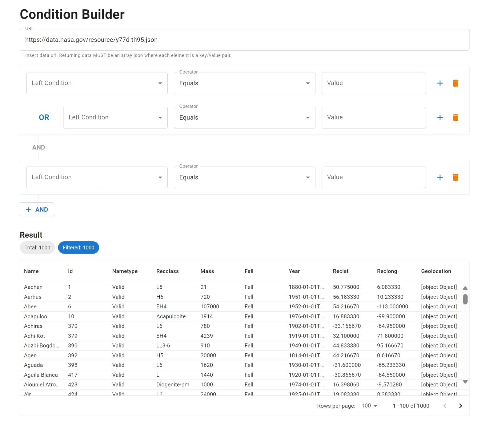
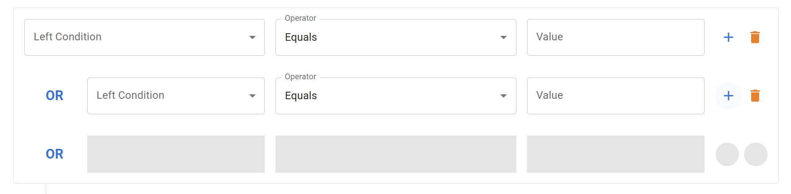

# Condition Builder


This take-home project is called the **Condition Builder**.
This tool allows you to load an array of data and layer in _AND_/_OR_ conditions to filter the data.




## Features Implemented

- ✅ User can load array of data from an URL.
      **Example URL:** https://data.nasa.gov/resource/y77d-th95.json
- ✅ User can build **or** conditions concatenated with **and** conditions.
  - For an example, any `c{n}` resolved to be a boolean (ex. name equals to "something"), then the condition can be formed as `(c1 || c2 || c3) && (c4 || c5)`.
- ✅ User can add `or` condition by pressing the plus button at the end of each row.
- ✅ User can add `and` condition by pressing the and button below each card container.
- ✅ User can see the list of loaded data on the bottom of the page.
- ✅ User can see the filtered data list when valid conditions are built.
- ✅ Visual feedback on where new `or` condition will be inserted when user hover over plus button (optional)
- ✅ Input validations
  - For comparison operators (Greater Than, Less Than), the entered value must be number.
  - For regex operator, the entered value must be a valid regex.
  - For URL input validate if it a valid URL




## Supported condition operators

Each condition should have few comparisons.

- Equals
- Greater than
- Less than
- Contain
- Not Contain
- Regex

In the end, these conditions filter out the source data.

### Tools/Languages

- **Dev Enviroment/Build Tool**
  - [Vite](https://vitejs.dev/)
- **UI Framework/Language**
  - [React](https://react.dev/) / [TypeScript](https://www.typescriptlang.org/)
- **Design System**
  - [Material UI (MUI)](https://mui.com/)
- **Unit Testing**
  - [Vitest](https://vitest.dev/)

## Potential Improvements/Enhancements

If this application was intended for production/at scale, I would include the following:

- **Dynamic Condition Grouping & Filtering**: Add OR Button to dynamically add a OR Condition Group to filter with Condition types(AND/OR) and not just AND Condition Groups.
- **Responsive Design**: Ensure usability across all devices.
- **Visual Logic Representation**: Use visual aids like lines or arrows to illustrate connections between conditions. Allow drag/drop of conditions to change order/sequence.
- **State Management Enhancements**: Use Context API and `useReducer` for more efficient state management.
- **Optimized Data Loading**: Implement data loading techniques like pagination or on-demand loading.
- **Error Handling**: Implement user-friendly error messages and better fallback mechanisms.
- **Enhanced Input Validation**: Strengthen validations to ensure format correctness, especially for complex conditions and data.
- **Accessibility Compliance**: Achieve WCAG standards for accessibility.
- **Internationalization**: Support multiple languages and formats.
- **Integration and Unit Testing**: Increase use of Vitest & React-testing-library for more complex interaction tests.
- **End-to-End Testing**: Use [cypress](https://www.cypress.io/) for comprehensive testing of user scenarios. Add code-coverage checks to build process to ensure coverage remains at/above a pre-determined level.
- **Condition Storage**: Enable saving and retrieving of user conditions in cloud/backend or `localStorage`.
- **Performance Profiling**: Regularly assess and optimize performance, particularly for complex condition handling.
- **Semantic versioning**: Implement proper versioning for production releases


### How To Run

Clone the repository locally, then run the following:

##### Install & Run Development Server:
```shell
$ npm install
$ npm run dev
```

##### Create & Preview Production Build:

```shell
$ npm run build # Required for preview
$ npm run preview
```

##### Running Tests:

```shell
$ npm run test
$ npm run test:ui
$ npm run test:coverage
```
